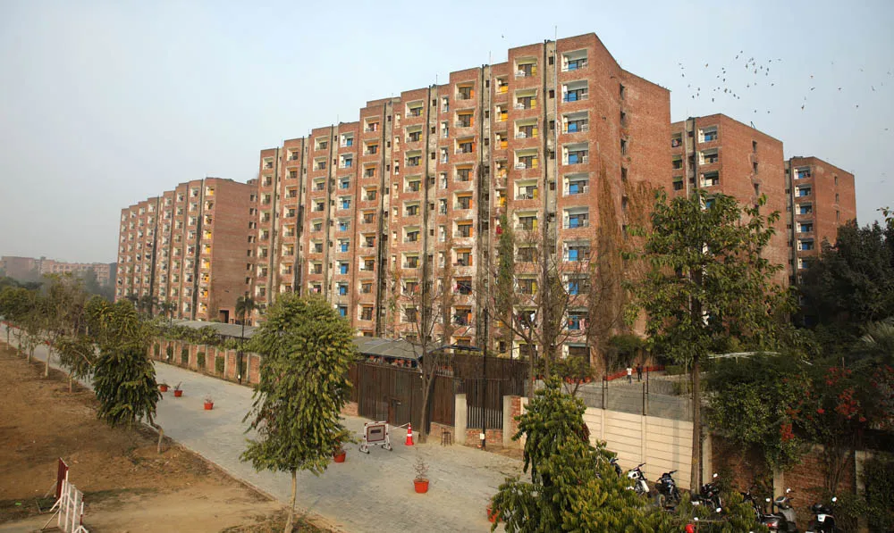
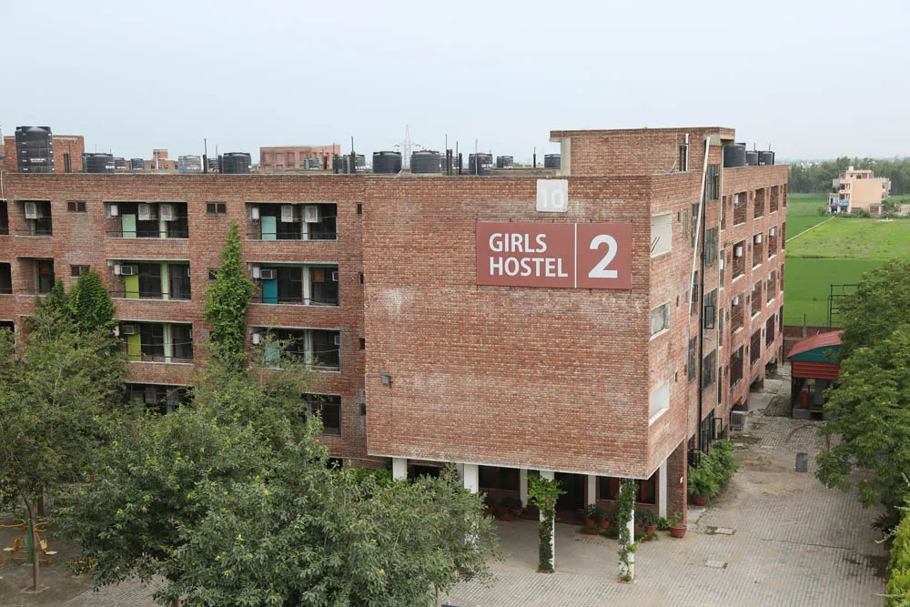
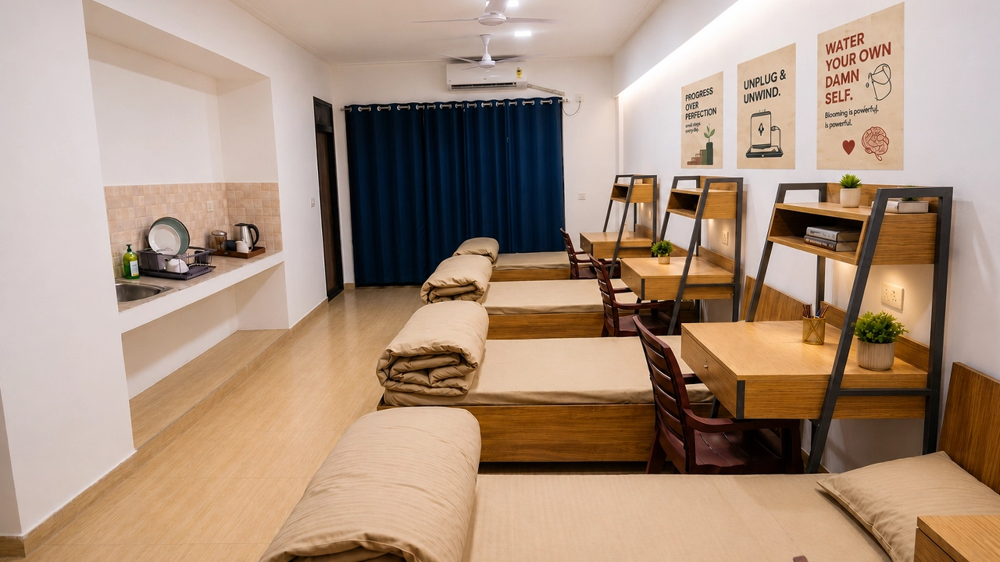
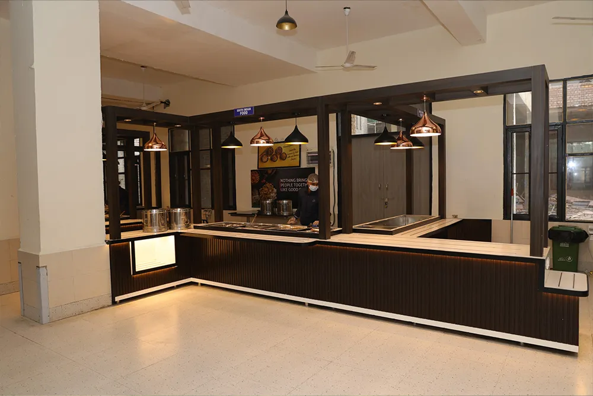
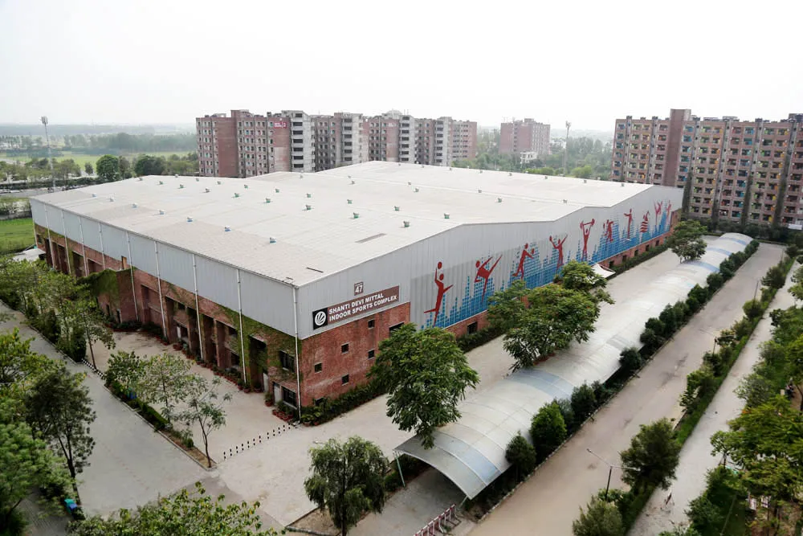
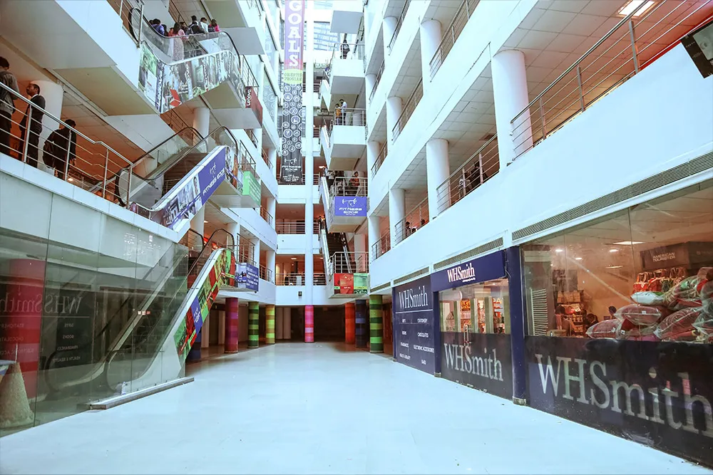

# LPU Hostel Allocation & Roommate Matching System

<div align="center">


### **Official-Style Smart Residential & Roommate Matching Portal for Lovely Professional University**

[](https://nextjs.org/)
[](https://reactjs.org/)
[](https://nodejs.org/)
[](https://www.mongodb.com/)
[](https://expressjs.com/)

[ Live Demo](https://hostelallocationlpuproject.vercel.app/) • [ Documentation](#project-structure) • [ Report Bug](https://github.com/vaishnavi339/HostelRoomAllocationSystem/issues) • [ Request Feature](https://github.com/vaishnavi339/HostelRoomAllocationSystem/issues)

</div>

---

## Table of Contents

- [Overview](#-overview)
- [Key Highlights & Latest Updates](#-key-highlights--latest-updates)
- [Features](#-features)
- [Tech Stack](#-tech-stack)
- [Project Structure](#-project-structure)
- [Module Architecture](#-module-architecture)
- [Installation & Setup](#-installation--setup)
- [Usage Guide](#-usage-guide)
- [API Documentation](#-api-documentation)
- [LPU Campus & Hostel Gallery Preview](#-lpu-campus--hostel-gallery-preview)
- [Vercel Deployment](#-vercel-deployment)
- [Contributing](#-contributing)
- [License](#-license)

---

## Overview

The **LPU Hostel Allocation & Roommate Matching System** is a full-stack residential portal built for **Lovely Professional University (Jalandhar – Delhi G.T. Road, Phagwara, Punjab)**. It streamlines hostel booking across **Boys Hostels (`BH-1` to `BH-9`)** and **Girls Hostels (`GH-1` to `GH-3`)**, combining **gender-based smart hostel recommendation at login**, **preference-based roommate matching**, **friend request & group booking**, and **automated 8-tier priority room allocation**.

---

##  Key Highlights & Latest Updates

- **Gender-Based Hostel Recommendation (`BH` for Boys / `GH` for Girls)**:
  - At student login (`/student/login`), the portal asks whether the student is **Male (Boy)** or **Female (Girl)**.
  - **Male (Boy)** students are automatically recommended **Boys Hostels (`BH-1` to `BH-9`)** and have their dashboard pre-filtered to `BH` blocks.
  - **Female (Girl)** students are automatically recommended **Girls Hostels (`GH-1` to `GH-3`)** and have their dashboard pre-filtered to `GH` blocks.
  - Includes **1-Click Demo Login** for both **Boy Student (`BH-1` to `BH-9`)** and **Girl Student (`GH-1` to `GH-3`)**.
-  **100% Authentic LPU Hostel & Campus Photography (`44+ Official Photos`)**:
  - Uses real photographs from **Lovely Professional University** (`public/images/lpu/`) across the entire application—zero generic or stock placeholders.
  - Showcases actual LPU `BH-1` to `BH-9` and `GH-1` to `GH-3` residential towers, AC/Non-AC Standard Rooms (1/2/3/4/5 Seater), AC Studio Apartments, Dormitories, Central Hostel Mess, Shanti Devi Mittal Auditorium, Central Library, Indoor Sports Complex (Olympic Pool, Badminton, Gym), Uni Mall, Uni Hospital, and Turnstile/Main Gate Security.
-  **Interactive Exterior / Room Interior Card View**:
  - Every hostel block card (`BH-1` to `BH-9`, `GH-1` to `GH-3`) includes a live toggle between **Building Exterior** and **Room Interior** photographs.
-  **30-Photo LPU Residential & Campus Gallery**:
  - Filterable by category (*Hostel Towers*, *Rooms & Apartments*, *Dining & Mess*, *Sports & Gym*, *Campus & Mall*, *Security & Care*) with a full-screen Lightbox modal.

---


## Features

###  For Students (`/student/login` & `/student/dashboard`)

-  **Gender Selection & Smart Wing Recommendation** — Select **Male (Boy)** or **Female (Girl)** at login to get tailored recommendations for **Boys Hostels (`BH-1` to `BH-9`)** or **Girls Hostels (`GH-1` to `GH-3`)**.
-  **Interactive Hostel Directory** — Inspect all 12 LPU hostel blocks (`BH-1`–`BH-9`, `GH-1`–`GH-3`) with real LPU photos, fee structures, mess fees, and live bed availability.
-  **LPU UMS-Style Booking Modes**:
  - **Individual Booking** — Apply solo with room category (`4-Seater`, `3-Seater`, `2-Seater`, `1-Seater`, `Dormitory`), AC/Non-AC, Mess plan, Floor preference, Quiet Zone, and Study-Focused tags.
  - **Roommate Group Booking** — Apply together as a 2–4 student group in the same room.
  - **Waitlist Priority Queue** — Join the CGPA-weighted priority queue for high-demand blocks.
-  **Friend Requests & Roommate Matching** — Send, receive, accept, or reject roommate friend requests by LPU Registration Number.
-  **Real-Time Application Tracker** — Track status (`SUBMITTED`, `UNDER_REVIEW`, `ALLOCATED`, `WAITLISTED`) and view complete fee breakdowns.

###  For Chief Warden & Administrators (`/admin/dashboard`)

-  **Live Occupancy Analytics** — Visual statistics across all 12 hostel blocks (`BH-1` to `BH-9` and `GH-1` to `GH-3`), total beds, occupied beds, and pending applications.
-  **Smart 8-Tier Allocation Engine**:
  - **Tier 1**: Complete roommate groups with matching block availability
  - **Tier 2**: Students with mutually accepted roommate friend requests
  - **Tier 3–5**: Floor, Quiet Zone, and Study-Focused lifestyle compatibility
  - **Tier 6–8**: CGPA-weighted priority & general pool allocation
-  **Application Review & Approval** — Filter applications by status, gender (`Male` / `Female`), department, and CGPA; approve or reject applications with one click.
-  **Hostel Inventory Overview** — Real-time capacity bar charts and real LPU exterior/interior imagery for every block.

---

## Tech Stack

### Frontend
- **Framework:** Next.js 14.2 (App Router)
- **Library:** React 18
- **Styling:** Tailwind CSS + Custom LPU Theme (`Orange #f97316` & `White`)
- **State & Persistence:** React Hooks (`useState`, `useEffect`, `useMemo`, `Suspense`) + `localStorage` gender & session sync

### Backend
- **Runtime:** Node.js
- **Framework:** Express.js 4
- **Architecture:** RESTful API (`/api/hostels`, `/api/applications`, `/api/allocations`, `/api/friend-requests`, `/api/rooms`, `/api/stats`)

### Database
- **Database:** MongoDB 7 (with automatic fallback to `mongodb-memory-server`)
- **ODM:** Mongoose 8
- **Seeder:** Automatic & standalone seeder (`server/seed.js`) populating `BH-1` to `BH-9` and `GH-1` to `GH-3`, 4,320 beds, sample students, and applications

---

##  Project Structure

```text
HostelRoomAllocationSystem/
│
├──  app/                          # Next.js 14 App Router (Frontend)
│   ├── page.js                      # Landing page: Hero, 12 Hostels, Room Types, 30-Photo Gallery
│   ├── globals.css                  # Global styles & animations
│   ├── layout.js                    # Root layout & metadata
│   │
│   ├──  components/               # Reusable UI components
│   │   ├── LpuLogo.js               # Official LPU Logo component
│   │   └── Chatbot.js               # Interactive LPU Hostel Assistant
│   │
│   ├──  student/                  # Student Portal
│   │   ├── login/page.js            # Gender selection (Boy->BH / Girl->GH) & Student Login
│   │   └── dashboard/page.js        # Personalized BH/GH recommendation, Booking, Friends & Groups
│   │
│   └──  admin/                    # Chief Warden / Admin Portal
│       ├── login/page.js            # Admin authentication
│       └── dashboard/page.js        # Occupancy analytics, Application review & Smart Allocation
│
├── server/                       # Express.js Backend API
│   ├── index.js                     # API server entry point (Port 5000)
│   ├── db.js                        # MongoDB connection with in-memory fallback
│   ├── seed.js                      # Seeds BH-1..BH-9 & GH-1..GH-3 with real LPU images
│   ├──  models/                   # Mongoose Models (Hostel, Room, Student, Application, etc.)
│   └──  routes/                   # REST API Route Handlers
│
├──  public/                       # Static Assets
│   └──  images/lpu/               # 44+ Official LPU Hostel, Room, Mess, Sports & Campus Photos
│
├──  docs/                         # Technical & Deployment Documentation
├── next.config.mjs                  # Next.js configuration
├── package.json                     # Dependencies & scripts
└── README.md                        # Project documentation
```

---

## Module Architecture

1. **Module 1: Gender-Aware Student Authentication** — Captures student gender (`Male` / `Female`) at login and maps Boys to `BH-1`–`BH-9` and Girls to `GH-1`–`GH-3`.
2. **Module 2: LPU Hostel & Room Inventory** — Manages 9 Boys Hostels (`BH-1` to `BH-9`) and 3 Girls Hostels (`GH-1` to `GH-3`) with real LPU photos and live bed counts.
3. **Module 3: Multi-Mode Application System** — Supports Individual, Group (2–4 roommates), and Waitlist applications.
4. **Module 4: Roommate Friend Request System** — Bi-directional friend request workflow using LPU Registration Numbers.
5. **Module 5: Automatic Roommate Group Formation** — Links accepted friends into co-allocated roommate groups.
6. **Module 6: 8-Tier Smart Allocation Engine** — Automated room assignment balancing group integrity, lifestyle preferences, and CGPA merit.
7. **Module 7: Chief Warden Analytics Dashboard** — Real-time occupancy monitoring, approval workflow, and allocation trigger.
8. **Module 8: Authentic LPU Visual Experience** — 30-photo filterable campus gallery, exterior/interior card toggles, and responsive mobile-first UI.

---

##  Installation & Setup

### Prerequisites
- **Node.js** 18+ installed
- **MongoDB** running locally on `mongodb://127.0.0.1:27017` (or automatic in-memory fallback)
- **Git** installed

### Step 1: Clone the Repository
```bash
git clone https://github.com/vaishnavi339/HostelRoomAllocationSystem.git
cd HostelRoomAllocationSystem
```

### Step 2: Install Dependencies
```bash
npm install
```

### Step 3: Configure Environment Variables (Optional)
Create a `.env` file in the root directory (defaults are pre-configured):
```env
MONGODB_URI=mongodb://127.0.0.1:27017/hostel_db
PORT=5000
NEXT_PUBLIC_API_URL=http://localhost:5000
```

### Step 4: Seed the Database with LPU Hostels & Photos
```bash
node ./server/seed.js
```

### Step 5: Run the Project
```bash
npm run dev
```
> **Note for Windows paths containing `&`**: If your folder path contains `&`, run the servers directly with `node`:
> ```powershell
> node ./server/index.js
> node ./node_modules/next/dist/bin/next dev -p 3000
> ```

- **Frontend Portal:** http://localhost:3000
- **Student Login:** http://localhost:3000/student/login
- **Student Dashboard:** http://localhost:3000/student/dashboard
- **Admin Dashboard:** http://localhost:3000/admin/dashboard
- **Backend API:** http://localhost:5000/api/hostels

---

##  Usage Guide

### Student Workflow
1. Visit **`/student/login`**.
2. **Step 1 — Select Gender**:
   - Choose ** Male (Boy)** → System immediately recommends **Boys Hostels (`BH-1` to `BH-9`)**.
   - Choose ** Female (Girl)** → System immediately recommends **Girls Hostels (`GH-1` to `GH-3`)**.
3. Enter your LPU Registration Number & UMS Password (or click **Demo Boy (`BH-1 to BH-9`)** / **Demo Girl (`GH-1 to GH-3`)** for instant autofill).
4. On **`/student/dashboard`**, review your personalized **Recommended Hostels Banner**, switch between `BH` or `GH` blocks, inspect real LPU room interiors, and submit an **Individual**, **Roommate Group**, or **Waitlist** booking.

### Administrator Workflow
1. Visit **`/admin/dashboard`**.
2. Review live occupancy across `BH-1`–`BH-9` and `GH-1`–`GH-3`.
3. Click **" Run Smart Allocation"** to execute the 8-tier roommate matching and bed assignment engine.
4. Approve or reject individual student applications in the **Applications** tab.

---

## 📡 API Documentation

| Method | Endpoint | Description |
| :--- | :--- | :--- |
| `GET` | `/api/health` | API health check & version info |
| `GET` | `/api/hostels` | List all 12 LPU hostels (`BH-1`–`BH-9`, `GH-1`–`GH-3`) with real LPU image paths & availability |
| `GET` | `/api/applications` | Fetch all submitted student hostel applications |
| `POST` | `/api/applications` | Submit a new hostel application with preferences & roommate IDs |
| `POST` | `/api/allocations/run` | Trigger the 8-tier smart hostel & roommate allocation algorithm |
| `POST` | `/api/friend-requests/send` | Send a roommate friend request by registration number |
| `GET` | `/api/friend-requests/received/:rollNumber` | List incoming roommate requests for a student |
| `PATCH` | `/api/friend-requests/:id/accept` | Accept a roommate request and form a booking group |

---

##  LPU Campus & Hostel Gallery Preview

<div align="center">
  <table>
    <tr>
      <td align="center">
        <br />
        <sub><b>LPU Boys Hostels (BH-1 to BH-9)</b></sub>
      </td>
      <td align="center">
        <br />
        <sub><b>LPU Girls Hostels (GH-1 to GH-3)</b></sub>
      </td>
      <td align="center">
        <br />
        <sub><b>LPU AC Residential Rooms & Apartments</b></sub>
      </td>
    </tr>
    <tr>
      <td align="center">
        <br />
        <sub><b>LPU Central Hostel Mess & Dining</b></sub>
      </td>
      <td align="center">
        <br />
        <sub><b>LPU Indoor Sports Complex & Gym</b></sub>
      </td>
      <td align="center">
        <br />
        <sub><b>LPU Uni Mall & Campus Plaza</b></sub>
      </td>
    </tr>
  </table>
</div>

---

##  Vercel Deployment

The frontend is deployed on Vercel with built-in static LPU hostel fallback data so all pages, real LPU photos, and interactive flows work seamlessly even without a live backend connection:

- **Production URL:** [https://hostelallocationlpuproject.vercel.app/](https://hostelallocationlpuproject.vercel.app/)

To deploy updates:
```bash
git add -A
git commit -m "Update LPU Hostel Portal"
git push origin main
```

---

## License

This project is licensed under the MIT License - see the [LICENSE](LICENSE) file for details.

---

<div align="center">

**LPU Hostel Room Allocation & Roommate Matching System**

 Star this repository if you find it helpful!

</div>

